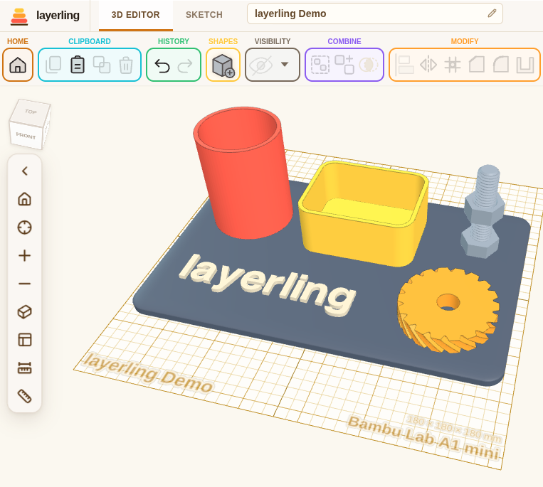

# Layerling for Unraid

  

Use this Docker if you want to save your CAD drawings in a central location, have more than one person access the same drawings, or just want to be completely independent of the internet. Otherwise you can just use the website for [Layerling](https://layerling.com/). It does all the same things, but all your drawings will save inside of your browser.

Community-maintained Docker template for [Layerling](https://layerling.com/).
The application and image come from [henmedia/layerling](https://github.com/henmedia/layerling).
This repository supplies installation metadata and does not build the image.

Easy 3D CAD for 3D printing

Drop a shape, cut a hole, round an edge, print it. In your browser, with no account and no CAD background. &#13;

Who It Is For;
You own a 3D printer. You want a part that fits something, not a career in CAD. layerling works the way you already think: put a shape on the plate, drag it to size, turn a second shape into a hole, group the two, export, print. There is nothing to learn before you start and nothing to sign up for open the page and build. Your designs stay in your own browser: no account, no cloud, nothing uploaded anywhere.

Coming From Tinkercad?
layerling sits a step beyond Tinkercad towards Fusion 360: it is operated the same way, so you will recognize everything the plate, the shapes, solids and holes, group and ungroup, bundle, Alt-drag for a copy but it does not stop where Tinkercad does. Things you have been missing are waiting for you.

## Installation settings

- Image: `ghcr.io/henmedia/layerling:latest`.
- Bridge networking; host port `3000` maps to container port `3000`.
- Web interface: `http://YOUR_UNRAID_IP:3000`.
- Shared designs: `/mnt/user/appdata/layerling/projects` maps to `/shared-projects`.
- `LAYERLING_SHARED_PROJECTS_DIR=/shared-projects` enables server storage.
- Runs as Unraid `nobody:users` (`99:100`) through `--user=99:100`.

Create/select a host projects directory writable by UID 99 and GID 100.
Layerling's upstream image normally runs as UID/GID 999; upstream documents
overriding the runtime user for writable bind mounts. Do not add PUID/PGID
variables: the upstream image does not document support for them.

Open **On the server** in Layerling to save shared designs. Designs saved in
the browser remain browser-local until moved. Back up the host projects folder.

