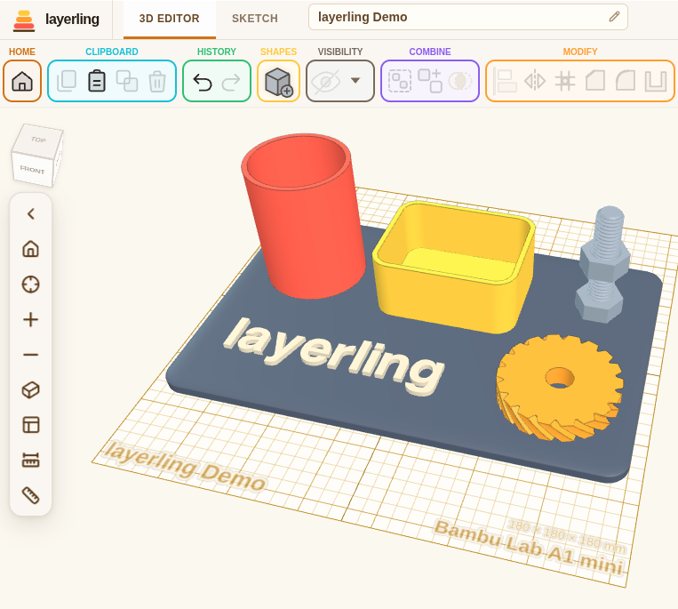

# jbat66's Unraid templates

Community Applications templates for Layerling and Prusa Print Monitor. This repository supplies the installation templates; application code and Docker images remain in their respective projects.

| Application | Template | Application / documentation | Support |
| --- | --- | --- | --- |
| Prusa Print Monitor | [prusa-print-monitor.xml](templates/prusa-print-monitor.xml) | [Prusa-Print-Monitor](https://github.com/jbat66/Prusa-Print-Monitor) | [Support discussion](https://github.com/jbat66/Prusa-Print-Monitor/discussions/1) |
| Layerling | [layerling.xml](templates/layerling.xml) | [henmedia/layerling](https://github.com/henmedia/layerling) | [Template issues](https://github.com/jbat66/unraid-templates/issues) |

## Community Apps submission

Use this existing repository (`https://github.com/jbat66/unraid-templates`) in the [Community Apps submission portal](https://ca.unraid.net/submissions). Validate and scan it to pick up new or updated templates; do not register the application code repository as a second template repository. The root `ca_profile.xml` describes both applications and `LICENSE` contains the template repository license.

The Prusa template's canonical URL is:

```text
https://raw.githubusercontent.com/jbat66/unraid-templates/main/templates/prusa-print-monitor.xml
```

Run `python tools/validate_templates.py` before pushing template changes. GitHub Actions runs the same validation automatically.

## Prusa Print Monitor

A PrusaLink printer dashboard with status, remaining time, filament-change countdowns, optional sound alerts and optional RTSP/HTTP camera viewing. The [application README](https://github.com/jbat66/Prusa-Print-Monitor#readme) covers printer credentials, all settings, sound setup and upgrades.

- Image: `ghcr.io/jbat66/prusa-print-monitor:latest`.
- Default web interface: `http://YOUR_UNRAID_IP:8085` (container port 8085).
- Replace the example printer IP and `PUT-KEY-HERE` before starting; the default Digest username is `maker`.
- Sounds Folder: `/mnt/user/appdata/prusa-print-monitor/sounds` mounted writable at `/sounds`.
- Sound File: `/mnt/user/appdata/prusa-print-monitor/sounds/AlarmSoundEffect.mp3`; four bundled MP3s are installed when missing, preserving existing files.
- Alerts and camera access default to disabled. Enable them in the template when wanted, then use the dashboard controls.
- The service runs as UID 10001 after the startup helper installs missing sound files. It has no login and is intended for a trusted LAN.

To install manually, save the [raw Prusa template](https://raw.githubusercontent.com/jbat66/unraid-templates/main/templates/prusa-print-monitor.xml) on UNRAID as `/boot/config/plugins/dockerMan/templates-user/my-prusa-print-monitor.xml`, then select it under **Docker → Add Container**. Existing users can keep the same container, image and settings; this migration only changes where the template is maintained. Re-download the canonical template when installing with the new location.

## Layerling for Unraid

<p align="center">
  
</p>


Use this Docker if you want to save your CAD drawings in a central location, have more than one person access the same drawings, or just want to be completely independent of the internet. Otherwise you can just use the website for [Layerling](https://layerling.com/). It does all the same things, but all your drawings will save inside of your browser.

Community-maintained Docker template for [Layerling](https://layerling.com/).
The application and image come from [henmedia/layerling](https://github.com/henmedia/layerling).
This repository supplies installation metadata and does not build the image.

Easy 3D CAD for 3D printing

Drop a shape, cut a hole, round an edge, print it. In your browser, with no account and no CAD background. &#13;

Who It Is For;
You own a 3D printer. You want a part that fits something, not a career in CAD. layerling works the way you already think: put a shape on the plate, drag it to size, turn a second shape into a hole, group the two, export, print. There is nothing to learn before you start and nothing to sign up for open the page and build. Your designs stay in your own browser: no account, no cloud, nothing uploaded anywhere.

Coming From Tinkercad?
layerling sits a step beyond Tinkercad towards Fusion 360: it is operated the same way, so you will recognize everything the plate, the shapes, solids and holes, group and ungroup, bundle, Alt-drag for a copy but it does not stop where Tinkercad does. Things you have been missing are waiting for you.

## Installation settings

- Image: `ghcr.io/henmedia/layerling:latest`.
- Bridge networking; host port `3000` maps to container port `3000`.
- Web interface: `http://YOUR_UNRAID_IP:3000`.
- Shared designs: `/mnt/user/appdata/layerling/projects` maps to `/shared-projects`.
- `LAYERLING_SHARED_PROJECTS_DIR=/shared-projects` enables server storage.
- Runs as Unraid `nobody:users` (`99:100`) through `--user=99:100`.

Create/select a host projects directory writable by UID 99 and GID 100.
Layerling's upstream image normally runs as UID/GID 999; upstream documents
overriding the runtime user for writable bind mounts. Do not add PUID/PGID
variables: the upstream image does not document support for them.

Open **On the server** in Layerling to save shared designs. Designs saved in
the browser remain browser-local until moved. Back up the host projects folder.


## Thumbnail storage

The **Thumbnails** path maps `/mnt/user/appdata/layerling/thumbnails` on Unraid
to `/app/.codex/project-thumbnails` inside the container. It preserves the
preview pictures stored there when the container is replaced or updated.
Keep the container path unchanged; choose another host folder if needed.
Both the projects and thumbnails host directories must be writable by UID 99
and GID 100. Include both directories in your appdata backups.

## Optional MCP access for AI clients

MCP lets a compatible AI client inspect and modify an open Layerling editor.
The template exposes these three environment variables in **Advanced View**
when adding or editing the container:

| Template entry | Environment variable | How to configure it |
| --- | --- | --- |
| Layerling MCP Remote | `LAYERLING_MCP_REMOTE` | Set to `true` to enable network access, or `false` to disable it. Defaults to `false`. |
| Layerling MCP Token | `LAYERLING_MCP_TOKEN` | Replace the example value with your own random secret of at least 16 characters. Use the same secret in the AI client's configuration. |
| Layerling MCP Allowed Hosts | `LAYERLING_MCP_ALLOWED_HOSTS` | Comma-separated server hostnames used to open Layerling. Replace `servername.local` with your hostname. Local IP addresses, bare hostnames, `.local`, and `.lan` names are already accepted upstream; explicitly list a custom domain, such as `cad.example.com`, if you use one. |

Apply the container changes. Open `http://YOUR_UNRAID_IP:3000/?editor=1`
and keep the editor open. Substitute your mapped host port if it differs.
Anyone with the token and network access can control open designs; keep the
secret private and use HTTPS outside a trusted network. For ordinary browser
use without AI tools, set Remote to `false`.

### Connect the AI client

The Docker settings enable Layerling's HTTP bridge. The AI client also needs
Layerling's MCP adapter running on its own computer; the bridge URL alone is
not a standalone MCP server URL.

1. Install Node.js and download or clone the
   [upstream Layerling repository](https://github.com/henmedia/layerling)
   onto the computer running the AI client. Keep the `scripts` directory intact:
   the adapter imports neighboring modules.
2. Register a local command/stdio MCP server in your client, running `node`
   with the absolute path to `scripts/layerling-mcp-server.mjs`.
3. Give that process `LAYERLING_URL` (the Layerling base URL on Unraid) and
   `LAYERLING_MCP_TOKEN` (the same secret configured in the container).

For a client that uses a JSON `mcpServers` configuration, merge this entry
into its existing configuration:

```json
{
  "mcpServers": {
    "layerling": {
      "command": "node",
      "args": ["C:/path/to/layerling/scripts/layerling-mcp-server.mjs"],
      "env": {
        "LAYERLING_URL": "http://YOUR_UNRAID_IP:3000",
        "LAYERLING_MCP_TOKEN": "REPLACE_WITH_YOUR_RANDOM_SECRET"
      }
    }
  }
}
```

Replace the script path, server address, and secret. Other clients may use
a different configuration format; use the same command, argument, and environment
values. Restart or reconnect the client, then ask:

> Use the Layerling MCP tools to list my open editors and inspect the current scene.

If the connection fails, check the server address and host port, matching tokens,
Remote setting, allowed hostname, and that an editor from this Unraid instance
is still open. Changes to environment variables require applying/recreating
the container, not just refreshing the browser.

See the upstream [NAS/server MCP instructions](https://github.com/henmedia/layerling#letting-an-ai-client-reach-a-copy-on-a-nas-or-server),
[client configuration example](https://github.com/henmedia/layerling/blob/main/docs/mcp/claude-desktop-config.example.json),
and [MCP adapter](https://github.com/henmedia/layerling/blob/main/scripts/layerling-mcp-server.mjs).
